# NeuralCanvas

**Turn a set of photographs of an object into a coloured 3D mesh, entirely on your own machine.**

NeuralCanvas is a full-stack web application around a multi-view 3D reconstruction pipeline. You upload photographs of an object, and it removes the backgrounds, estimates camera poses with [COLMAP](https://colmap.github.io/), trains a neural radiance field with NVIDIA [Instant-NGP](https://github.com/NVlabs/instant-ngp), extracts and cleans a mesh, and exports it as GLB, OBJ and PLY. A browser workspace shows every stage, the live logs, hardware telemetry and a 3D preview of the result.

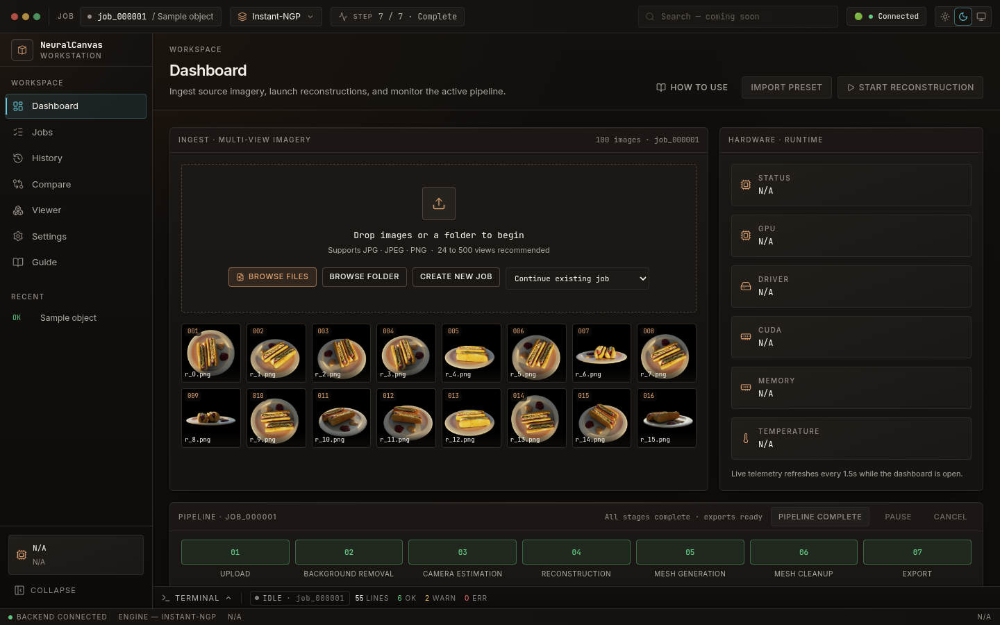

> **Status: alpha, under active development.** The image-to-3D pipeline works end to end on a single Linux workstation. See [Limitations](#limitations) and [Roadmap](#roadmap) before relying on it.
>
> **New to NeuralCanvas?** The in-app **[user guide](#user-guide)** (`/guide`) walks through photographing an object, running the pipeline and exporting the model.

---

## Contents

- [Features](#features)
- [How the pipeline works](#how-the-pipeline-works)
- [Architecture](#architecture)
- [Requirements](#requirements)
- [Installation](#installation)
- [Configuration](#configuration)
- [Running NeuralCanvas](#running-neuralcanvas)
- [Using the application](#using-the-application)
- [User guide](#user-guide)
- [Export formats](#export-formats)
- [API overview](#api-overview)
- [Project structure](#project-structure)
- [Testing](#testing)
- [Limitations](#limitations)
- [Roadmap](#roadmap)
- [Text-to-3D (future direction)](#text-to-3d-future-direction)
- [Screenshots](#screenshots)
- [Credits and licences](#credits-and-licences)

## Features

- **Multi-image reconstruction.** Upload JPG/PNG photographs (or a folder) into a job and run a seven-stage pipeline.
- **Background removal.** Masks each image with [rembg](https://github.com/danielgatis/rembg) before reconstruction.
- **Camera estimation.** COLMAP feature extraction, exhaustive matching and sparse mapping, converted to an Instant-NGP `transforms.json`. The stage fails clearly when too few images register.
- **Neural reconstruction.** Instant-NGP training runs as a subprocess, with live progress, loss and step-rate logging.
- **Mesh extraction.** Marching cubes over the trained density field.
- **Mesh cleanup.** Repair, floater removal, Taubin smoothing and adaptive quadric decimation. The Stage 5 mesh is never modified.
- **Verified exports.** Original and cleaned meshes in GLB, OBJ and PLY, each checked on disk before it is offered.
- **3D viewer.** A Three.js preview with wireframe and stats, plus the original and masked source images.
- **Live monitoring.** Per-stage progress, an incremental log terminal, and GPU/CPU/RAM/VRAM telemetry from `nvidia-smi`.
- **Recorded statistics only.** Job status, final loss, throughput (steps/s), checkpoints, peak VRAM, training time and total pipeline time come from recorded job data. A value that was never captured for an older run reads **Not recorded**; one that the pipeline does not measure at all (PSNR) reads **Not evaluated**. Neither is ever shown as a number.
- **Built-in user guide** at `/guide`: capture tips, the seven stages, reading the statistics, exporting, and troubleshooting.
- **Resumable pipeline.** Run the whole pipeline, run or retry a single stage, or reset from a stage, without repeating earlier work.
- **Dark (Graphite) and light (Sand) themes**: blue-tinted graphite with copper and champagne accents, and sand, taupe and champagne with a lavender haze, built on one shared set of design tokens. Cyan/soft blue marks selected and focused elements. The log terminal stays a dark console in both themes.
- **Adjustable sidebar**: drag its edge (or use the arrow keys on the handle) to resize it, collapse it to an icon rail, double-click the handle to reset. Width and collapsed state are remembered in the browser. On phones it is a menu drawer instead.

## How the pipeline works

Each job is a folder under `jobs/<job_id>/`. Stage state (status, progress, start and end times) is stored in `pipeline.json` and job metadata in `metadata.json`. A job's overall status and progress are always derived by the backend from the persisted stages, so they stay correct across restarts and for jobs created by older versions.

| # | Stage | What happens | Main output |
|---|---|---|---|
| 1 | **Upload** | Images are validated (JPG/PNG, max 50 MB and 40 MP each, max 100 files per request) and thumbnails are generated. | `uploaded_images/` |
| 2 | **Background removal** | rembg produces an RGBA cut-out for each image. | `masked_images/` |
| 3 | **Camera estimation** | COLMAP `feature_extractor` → `exhaustive_matcher` → `mapper`. The best sparse model is converted to `transforms.json`. The stage fails if fewer than `COLMAP_MIN_REGISTRATION_RATIO` of the images register. | `camera/transforms/transforms.json` |
| 4 | **Reconstruction** | Instant-NGP `scripts/run.py --scene … --n_steps … --save_snapshot …`. Final loss, steps/s, checkpoint count and peak VRAM (sampled with `nvidia-smi`) are recorded. | `instant_ngp/snapshot.msgpack`, `training.log` |
| 5 | **Mesh generation** | Instant-NGP marching cubes (`--marching_cubes_res`, `--marching_cubes_density_thresh`). | `meshes/<run>/mesh.{ply,obj,glb}` |
| 6 | **Mesh cleanup** | trimesh repair, removal of small disconnected pieces, Taubin smoothing, and decimation above a face-count threshold. A `cleanup.json` report is written. | `meshes/<run>/cleanup/<id>/mesh.{ply,obj,glb}` |
| 7 | **Export** | Verifies the original and cleaned files on disk and writes a manifest. The viewer prefers the cleaned GLB. | `exports/manifest.json` |

### About Instant-NGP

[Instant-NGP](https://github.com/NVlabs/instant-ngp) (Müller et al., SIGGRAPH 2022) trains a NeRF in minutes using a multiresolution hash encoding and fully fused CUDA MLPs.

NeuralCanvas does not ship Instant-NGP. It drives your local build through its own `scripts/run.py`, using the interpreter set in `INSTANT_NGP_PYTHON`, which must match the Python version the `pyngp` bindings were compiled for.

On startup the backend checks that the checkout, the build and the Python bindings are present, and blocks reconstruction with a clear error if they are not.

## Architecture

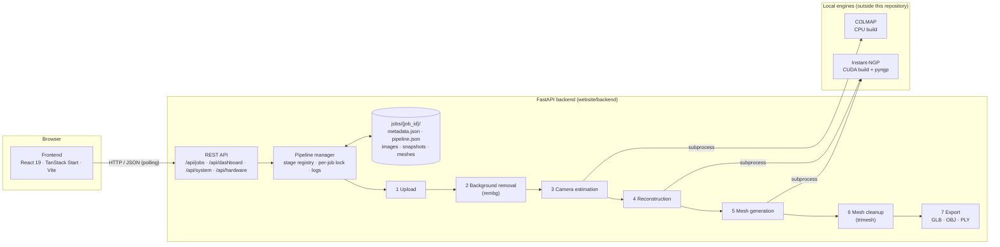

- **Frontend** (`frontend/`): React 19 with TanStack Router/Start, TanStack Query, Zustand, Tailwind CSS 4, Three.js (react-three-fiber/drei) and Framer Motion. It polls the backend for pipeline state and incremental logs.
- **Backend** (`backend/`): FastAPI, Pydantic and Uvicorn. Each engine sits behind an adapter interface (`app/engines/<kind>/base.py`), and the pipeline manager runs registered stages in order. Job state lives on the filesystem; there is no database.
- **Engines**: COLMAP and Instant-NGP are separate local builds, called as subprocesses. They are **not** part of this repository.

## Requirements

### Software

| Component | Version / notes |
|---|---|
| OS | Linux. Developed and tested on Arch Linux; other platforms are untested. |
| Python | **3.10** for the backend virtual environment. It must match the Python used to build Instant-NGP's `pyngp`. |
| Node.js | **22.12 or newer** (required by TanStack Start); npm. Tested with Node 26. |
| NVIDIA driver + CUDA toolkit | Whatever your Instant-NGP build needs. Developed with driver 610 / CUDA 13.3. |
| COLMAP | A local build or a packaged binary. CPU-only works (`COLMAP_USE_GPU=false`). |
| Instant-NGP | A local CUDA build with Python bindings (`build/pyngp*.so`). |

### Hardware

| | Minimum (what this project was developed on) | Recommended |
|---|---|---|
| GPU | NVIDIA GPU supported by Instant-NGP. An **RTX 2050 with 4 GB VRAM** works for ~100 images at 800×800 (measured peak ≈1.35 GB during training). | 8 GB+ VRAM for larger or higher-resolution captures |
| RAM | ~15 GB | 16 GB+ |
| CPU | Multi-core x86-64. COLMAP on CPU is the slowest stage on modest CPUs. | More cores speed up COLMAP |
| Disk | A few hundred MB per job (images, COLMAP database, snapshot, meshes) | SSD with tens of GB free |

On the 4 GB card, 35,000 training steps took about 21 minutes. Larger datasets, higher image resolutions or other GPU workloads can exceed 4 GB.

## Installation

**What this repository contains.** This repository holds the NeuralCanvas application source: the FastAPI backend (`backend/`) and the web frontend (`frontend/`). It does **not** include COLMAP, Instant-NGP, model weights, datasets or job data. The two reconstruction engines are external prerequisites: install them yourself (step 2) and point the backend at them in `backend/.env` (see [Configuration](#configuration)).

**Two kinds of paths.** Paths such as `backend/.env` or `frontend/src/` are relative to the cloned repository. Relative paths *inside* `backend/.env` (for example `JOBS_ROOT=jobs`) are instead resolved against the **workspace root**, which is outside the repository:

- by default, the directory that contains the cloned repository;
- if a directory further up contains both `engines/instant-ngp/` and `website/backend/`, that directory (`app/core/paths.py`).

Absolute paths in `.env` are used as given. The commands below assume this layout, where only `website/` comes from GitHub:

```
<workspace>/              ← any directory you choose (not part of the repository)
├── website/              ← this repository, cloned as "website"
├── engines/instant-ngp/  ← optional: your own Instant-NGP build (matches the default INSTANT_NGP_ROOT)
└── jobs/                 ← created by the backend at runtime
```

### 1. Clone

```bash
mkdir neuralcanvas && cd neuralcanvas      # your workspace root
git clone https://github.com/Parth-Dhunde/neural-canvas.git website
```

### 2. Install the reconstruction engines (not included)

Follow each project's own instructions. NeuralCanvas only calls the results:

- **Instant-NGP**: clone and build it *with Python bindings* ([build instructions](https://github.com/NVlabs/instant-ngp#building-instant-ngp-windows--linux)), in any location. The checkout must contain `build/pyngp.cpython-310-*.so` (or the equivalent for your Python version) and `scripts/run.py`. Set `INSTANT_NGP_ROOT` in `backend/.env` to the checkout's absolute path, or place the checkout at `<workspace>/engines/instant-ngp` to use the default.
- **COLMAP**: install a packaged binary or [build it from source](https://colmap.github.io/install.html). Then either put `colmap` on your `PATH` or set `COLMAP_BINARY` in `backend/.env` to the executable's absolute path.

### 3. Backend

```bash
cd website/backend
python3.10 -m venv .venv
source .venv/bin/activate
pip install -r requirements.txt
pip install pytest            # only needed to run the test suite
cp .env.example .env          # then edit .env (see Configuration)
```

`rembg` downloads its U²-Net model on first use (into `~/.u2net/`).

### 4. Frontend

```bash
cd website/frontend
npm install
```

## Configuration

All backend settings are read from `backend/.env` in the repository (see [`backend/.env.example`](backend/.env.example)). `.env` is ignored by git. The defaults are safe, and the file needs no secrets or API keys.

| Variable | Default | Purpose |
|---|---|---|
| `JOBS_ROOT` | `jobs` | Job workspaces. Relative to the workspace root (outside the repository), or an absolute path |
| `COLMAP_BINARY` | `colmap` | COLMAP executable name or absolute path |
| `COLMAP_USE_GPU` | `false` | Use COLMAP's GPU SIFT/matching if your build supports it |
| `COLMAP_CAMERA_MODEL` | `OPENCV` | COLMAP camera model |
| `COLMAP_MIN_REGISTRATION_RATIO` | `0.5` | Fail Stage 3 if fewer than this fraction of masked images register |
| `INSTANT_NGP_ROOT` | `engines/instant-ngp` | Your external Instant-NGP checkout (not included in this repository). Relative to the workspace root, or an absolute path |
| `INSTANT_NGP_PYTHON` | `python3` | Interpreter that can import `pyngp`. **Use an absolute path** (for example `…/website/backend/.venv/bin/python`) so the result doesn't depend on `PATH`. |
| `INSTANT_NGP_N_STEPS` | `35000` | Training steps |
| `MESH_RESOLUTION` | `256` | Marching-cubes resolution |
| `MESH_DENSITY_THRESHOLD` | `2.5` | Marching-cubes density threshold |
| `MESH_CLEANUP_*` | see `.env.example` | Smoothing, floater removal and decimation parameters |

The bind address and port are not read from `.env`; they come from the `uvicorn --host` and `--port` flags (see [Running NeuralCanvas](#running-neuralcanvas)).

Frontend (optional, `frontend/.env` in the repository):

| Variable | Default | Purpose |
|---|---|---|
| `VITE_BACKEND_URL` | `http://localhost:8000` | Backend base URL. You can also change it in **Settings**. |

## Running NeuralCanvas

Start the backend and the frontend in two terminals.

```bash
# Terminal 1 — backend
cd website/backend
source .venv/bin/activate
uvicorn app.main:app --host 127.0.0.1 --port 8000 --reload
```

```bash
# Terminal 2 — frontend
cd website/frontend
npm run dev
```

Open the URL Vite prints (by default **http://localhost:5173**). Interactive API docs are at **http://localhost:8000/docs**.

On startup the backend logs whether the workspace, the Instant-NGP build and the Python bindings were found. The **Connected** badge in the top bar shows the same checks.

> `--reload` restarts the server whenever a backend file changes. A pipeline run executes inside its HTTP request, so a reload interrupts it. Leave out `--reload` for long runs.

## Using the application

1. **Create a job.** On the Dashboard, choose **Create New Job** (or pick an existing job under *Continue existing job*).
2. **Upload photographs.** Drag images or a folder onto the ingest area, or use **Browse files** / **Browse folder**.
   - Take 24–500 sharp photos that circle the object, with plenty of overlap between neighbouring shots.
   - Keep the lighting consistent and the background uncluttered.
   - Transparent and very shiny objects are hard to reconstruct.
3. **Start the reconstruction.** Click **Start Reconstruction** (or **Run remaining stages** on the Pipeline panel). Every remaining stage runs in order. If a stage fails, its error appears in the terminal and you can retry from that stage.
4. **Monitor progress.** Watch the stage progress bars, the terminal (live, searchable logs), the hardware panel and the top-bar step indicator. A job's status is `waiting`, `running`, `paused`, `cancelled`, `failed` or `completed`, as reported by the backend.
5. **Inspect the result.** When the run finishes, the **Pipeline Snapshot** shows the final loss, throughput, checkpoints, peak VRAM, training time and total pipeline time. Open **Viewer** to orbit the mesh, toggle wireframe, compare the cleaned and original meshes, and browse the original and masked images.
6. **Export.** Download GLB, OBJ or PLY from the Viewer's export panel or through the API. **History** lists completed jobs with their exports, and failed jobs with the stage and error that stopped them.

If the workspace contains experiment records (`<workspace>/outputs/experiments/*/*/metrics.json`, located via `OUTPUTS_ROOT`), the dashboard lists them separately as **Experimental · not production**. They are read-only, come from runs outside the normal pipeline, and never enter the production statistics.

To re-run cleanup and export on an existing mesh without retraining:

```bash
curl -X POST http://localhost:8000/api/jobs/<job_id>/pipeline/stages/6/reset
curl -X POST http://localhost:8000/api/jobs/<job_id>/pipeline/stages/6/run
curl -X POST http://localhost:8000/api/jobs/<job_id>/pipeline/stages/7/run
```

## User guide

Open **Guide** in the sidebar, or **How to use** on the dashboard, for a beginner-friendly walkthrough written for people who have never used NeRF or 3D-reconstruction software:

- what NeuralCanvas and a NeRF are, and how multi-view reconstruction works;
- how to photograph an object (with do/avoid lists) and what the upload limits are;
- creating or continuing a job, the seven pipeline stages, monitoring progress and logs;
- what each hardware and training statistic means, including *Not recorded* and *Not evaluated*;
- inspecting the model in the viewer, how cleanup works, and exporting GLB/OBJ/PLY;
- troubleshooting common errors (disconnected backend, COLMAP missing, too few registered images, Python mismatch, CUDA out of memory, missing parts, fragments) and tips for better results.

The guide's screenshots are real captures of the application in both themes (`frontend/public/guide/`).

## Export formats

| Format | Original (Stage 5) | Cleaned (Stage 6) | Notes |
|---|---|---|---|
| **GLB** | ✓ | ✓ | Binary glTF with vertex colours (`COLOR_0`). The viewer uses this format. |
| **OBJ** | ✓ | ✓ | Vertex colours written as extra values on `v` lines (widely read, but non-standard) |
| **PLY** | ✓ | ✓ | Vertex colours |

Meshes carry vertex colours, not UV textures. FBX, USDZ and STL are shown in the UI but are not implemented.

## API overview

All routes are listed with request and response schemas at `/docs`.

| Method | Endpoint | Description |
|---|---|---|
| GET | `/health`, `/version` | Liveness and version |
| GET | `/api/system/engines` | Workspace and Instant-NGP installation status |
| GET | `/api/hardware` | GPU, driver, CUDA, RAM/VRAM and temperature telemetry |
| GET | `/api/dashboard/summary` | Job counts, median training time, storage, per-engine medians (with sample sizes) |
| POST / GET | `/api/jobs` | Create a job / list jobs |
| GET | `/api/jobs/{id}` | Job record with derived status, progress, stages, timings and training metrics |
| POST | `/api/jobs/{id}/upload` | Upload images (multipart `files`) |
| GET | `/api/jobs/{id}/preview/{filename}`, `/images/{original\|masked}/{filename}` | Thumbnails and source images |
| GET | `/api/jobs/{id}/pipeline` | Stage states and execution status |
| GET | `/api/jobs/{id}/logs?after=&limit=&tail=` | Incremental pipeline logs |
| POST | `/api/jobs/{id}/pipeline/start` | Run all remaining stages. **Blocks until the run stops.** |
| POST | `/api/jobs/{id}/pipeline/stages/{n}/run` | Run or retry one stage |
| POST | `/api/jobs/{id}/pipeline/stages/{n}/reset` | Reset stage *n* and later stages to waiting (no files are deleted) |
| POST | `/api/jobs/{id}/pipeline/{pause\|resume\|cancel\|recover}` | Execution control |
| GET | `/api/jobs/{id}/mesh` | Stage 5 GLB |
| GET | `/api/jobs/{id}/exports` | Verified export manifest |
| GET | `/api/jobs/{id}/exports/{cleaned\|original}/{glb\|obj\|ply}` | Download a mesh |

## Project structure

```
website/                      # this repository
├── backend/
│   ├── app/
│   │   ├── api/              # FastAPI routers (jobs, dashboard, system, hardware)
│   │   ├── core/             # settings, logging, workspace path resolution
│   │   ├── engines/          # adapters: background_removal, camera_estimation (COLMAP),
│   │   │                     #   instant_ngp, reconstruction, mesh_generation, mesh_cleanup
│   │   ├── jobs/             # job repository, pipeline.json persistence, lifecycle, logs
│   │   ├── models/           # Job domain model
│   │   ├── pipeline/         # pipeline manager, stage registry, stages/
│   │   ├── schemas/          # Pydantic request/response models
│   │   └── services/         # upload, export, dashboard statistics, hardware, GPU sampling
│   ├── tests/                # pytest suite
│   ├── .env.example
│   ├── pyproject.toml
│   └── requirements.txt
├── frontend/
│   ├── src/
│   │   ├── components/       # shell (sidebar, top bar, terminal), pipeline, viewer, ui-pro
│   │   ├── hooks/            # backend health, job sync, pipeline polling, theme
│   │   ├── lib/              # pure helpers (dashboard stats, mesh selection, uploads, theme)
│   │   ├── routes/           # file-based pages: dashboard, jobs, history, compare, viewer,
│   │   │                     #   settings, guide
│   │   ├── services/         # typed API clients
│   │   ├── store/            # Zustand app state
│   │   └── styles.css        # design tokens for both themes
│   ├── public/guide/         # screenshots used by the /guide page
│   ├── tests/                # node:test unit tests
│   └── package.json
├── docs/screenshots/
├── LICENSE
└── README.md
```

## Testing

```bash
# Backend
cd website/backend && .venv/bin/python -m pytest

# Frontend
cd website/frontend
npm test              # unit tests (node --test)
npx tsc --noEmit      # type check
npm run lint          # ESLint + Prettier
```

The tests use temporary job folders and never touch your `jobs/` directory.

## Limitations

- **Single machine, single user.** There is no authentication and CORS allows any origin. The documented command binds to `127.0.0.1`; starting `uvicorn` with `--host 0.0.0.0` exposes the API to your network.
- **No job queue or cross-job GPU lock.** Runs execute inside the HTTP request that starts them. Starting reconstructions for two jobs at once can exhaust a small GPU.
- **Pause and Cancel** exist in the API but are not yet wired up in the dashboard.
- **No quality metrics in production.** PSNR is not evaluated, so the dashboard's *Median PSNR* reads *Not evaluated*. Throughput is reported in steps/s because Instant-NGP's CLI does not log rays/s. Jobs trained before VRAM and stage-time recording existed show *Not recorded* for peak VRAM and pipeline time.
- **Mesh quality depends on the capture.**
  - Regions no camera saw (for example, the underside of an object resting on a surface) are inferred from silhouettes.
  - Background removal can clip thin parts.
  - Raw meshes can contain small fragments and internal cavities. Stage 6 removes the smallest pieces, but does not fill cavities.
- **Vertex colours only.** There are no UV textures or PBR materials.
- **Not yet implemented (shown disabled, with the reason on hover):** the Compare page, top-bar search, *Import Preset*, job deletion, CSV/report export, viewport snapshots, FBX/USDZ/STL export, and most Settings rows (reconstruction, mesh and export parameters are configured in `backend/.env`; only *Backend URL* and *Theme* apply from the UI, and settings are not saved between page loads).
- **Linux only so far**, and hardware telemetry needs `nvidia-smi`.

## Roadmap

Planned work. None of it is available yet.

- A **Text-to-3D** mode as a separate engine adapter (see below).
- A job queue, a GPU lock shared between jobs, and Pause/Cancel controls in the UI.
- Optional quality evaluation (held-out-view PSNR).
- An engine comparison view.

## Text-to-3D (future direction)

Instant-NGP needs many photographs of a real object. A planned second workflow would let a user type a description and generate a 3D model without photos. **Nothing of this is implemented, installed or exposed in the UI.** The requirement is that it runs locally and free of charge: no paid APIs, credits or mandatory API keys.

Research so far (to be verified before any installation; nothing has been measured on the target GPU):

| Candidate | Text → 3D directly? | Notes |
|---|---|---|
| **Shap-E** (OpenAI) | Yes | Code and weights reported as MIT (verify the exact weights and dependencies). Small model; *may* fit the 4 GB RTX 2050, **not yet measured**. Output is low-detail. Leading candidate. |
| **TripoSR** (Stability AI / Tripo) | No, image → 3D | MIT. Would need a text-to-image step first; around 6 GB VRAM by default, so 4 GB is unproven. |
| TRELLIS (Microsoft), Hunyuan3D (Tencent), Cube 3D (Roblox) | Varies | Reported to need roughly 16 GB+ of GPU memory for full quality; Hunyuan3D's licence also excludes some regions. Unlikely to fit the current hardware. |

The backend is ready to host a second engine without touching the photo pipeline: every engine sits behind an adapter interface in `backend/app/engines/<kind>/`, jobs carry a `job_type` field (currently always `image_to_3d`), and the dashboard statistics are grouped per engine.

## Screenshots

All screenshots are real captures of a running instance (no mockups).

> **Sample data:** the scene shown is 100 RGBA 800×800 views named `r_0.png`–`r_99.png` of a hot dog on a plate. It closely resembles the *hotdog* scene of the NeRF synthetic (Blender) dataset (Mildenhall et al., 2020), but its source has **not been confirmed**. If you redistribute it, check its origin and terms first.

| User guide (dark) | User guide (light) |
|---|---|
| 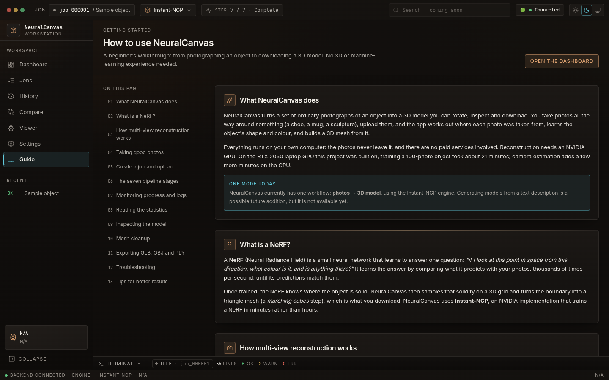 | 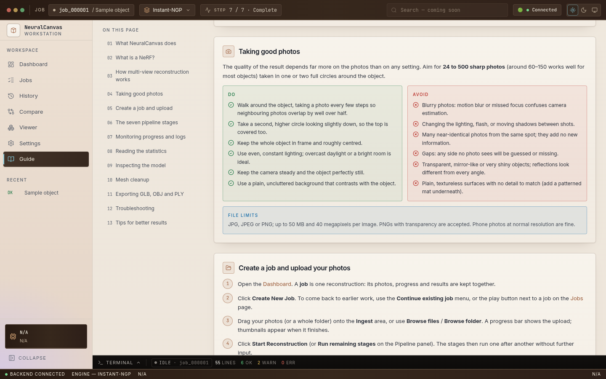 |

| Dashboard (light) | Pipeline stages |
|---|---|
| 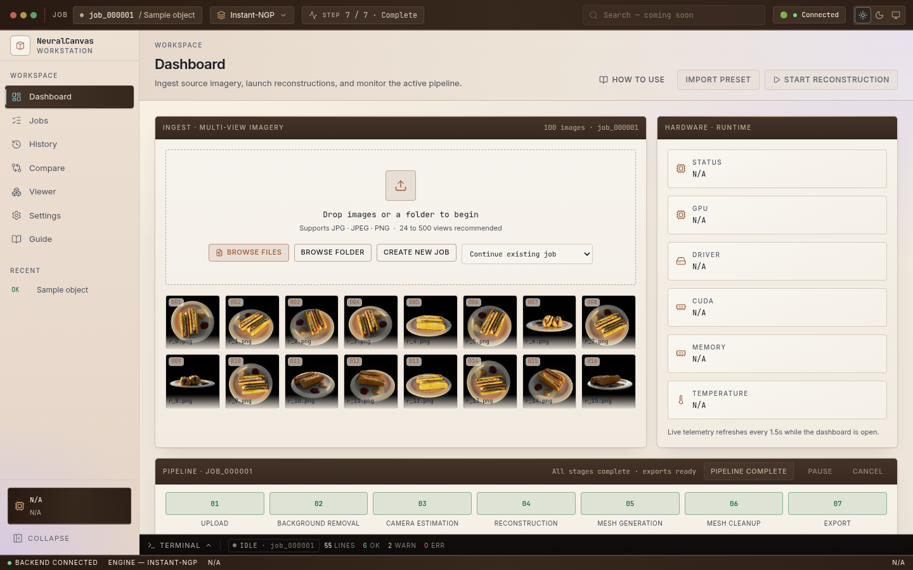 | 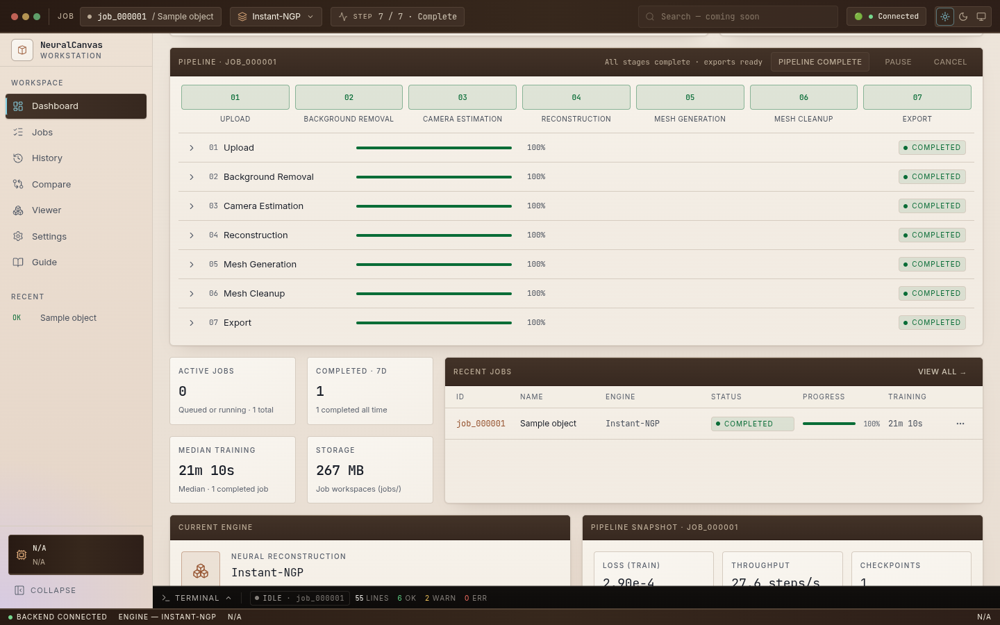 |

| Job statistics and Pipeline Snapshot | 3D viewer |
|---|---|
| 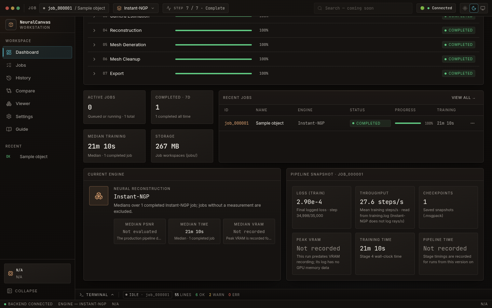 | 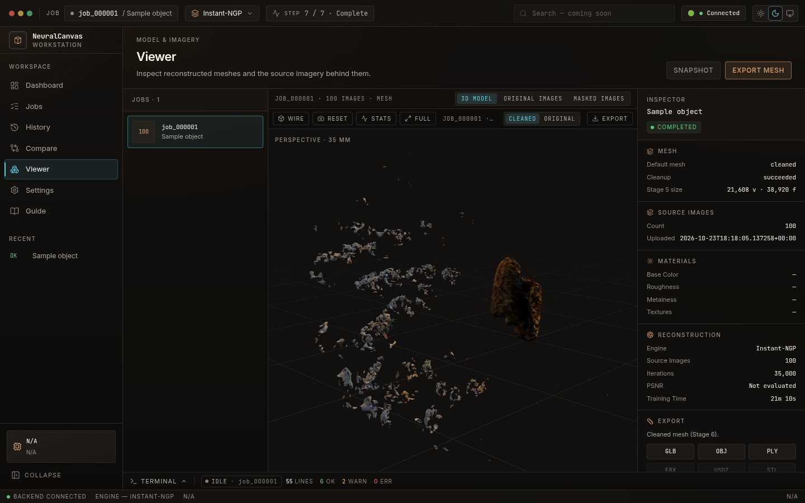 |

| Collapsed sidebar (icon rail) | Dashboard (dark) |
|---|---|
| 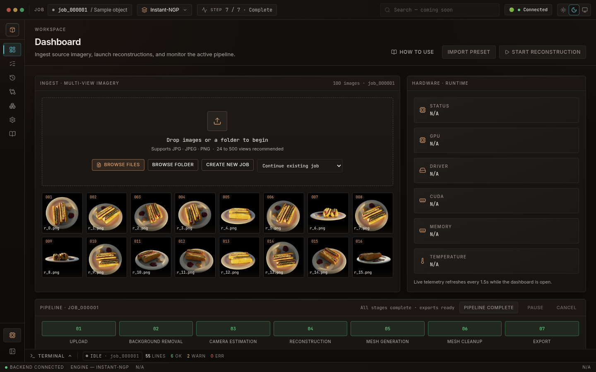 |  |

| History | Mobile |
|---|---|
| 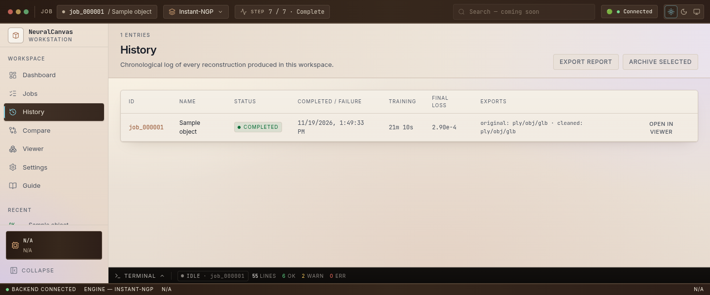 | 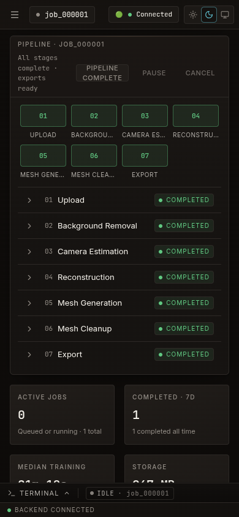 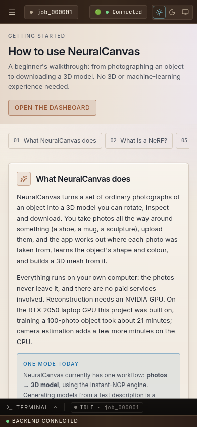 |

The viewer screenshot shows the mesh exactly as the current production pipeline produces it, small fragments included.

## Credits and licences

NeuralCanvas is designed and built by **Parth Dhunde**.

The NeuralCanvas source code in this repository is released under the [MIT License](LICENSE).

**The MIT licence covers only this repository's code.** NeuralCanvas runs third-party software and models that keep their own licences. In particular:

| Project | Role | Licence |
|---|---|---|
| [Instant-NGP](https://github.com/NVlabs/instant-ngp), NVIDIA | Reconstruction and meshing | **NVIDIA Source Code License (non-commercial / research use)** |
| [COLMAP](https://github.com/colmap/colmap), J. L. Schönberger et al. | Camera estimation | BSD-3-Clause (its dependencies have their own licences) |
| [rembg](https://github.com/danielgatis/rembg), D. Gatis | Background removal | MIT |
| [U²-Net](https://github.com/xuebinqin/U-2-Net), X. Qin et al. | Model downloaded by rembg | Apache-2.0 |
| [trimesh](https://github.com/mikedh/trimesh), [fast-simplification](https://github.com/pyvista/fast-simplification), [pygltflib](https://gitlab.com/dodgyville/pygltflib) | Mesh processing and export | MIT |
| [FastAPI](https://fastapi.tiangolo.com/), [Pydantic](https://docs.pydantic.dev/), [Uvicorn](https://www.uvicorn.org/) | Backend | MIT / MIT / BSD-3-Clause |
| [React](https://react.dev/), [TanStack](https://tanstack.com/), [Three.js](https://threejs.org/), [react-three-fiber / drei](https://github.com/pmndrs), [Tailwind CSS](https://tailwindcss.com/), [Zustand](https://github.com/pmndrs/zustand), [Lucide](https://lucide.dev/) | Frontend | MIT (Lucide: ISC) |

Because Instant-NGP is licensed for non-commercial use, **any use of the full NeuralCanvas pipeline is subject to NVIDIA's licence terms.** Check each dependency's licence before any commercial use.

References:
- T. Müller, A. Evans, C. Schied, A. Keller. *Instant Neural Graphics Primitives with a Multiresolution Hash Encoding.* ACM TOG (SIGGRAPH), 2022.
- J. L. Schönberger, J.-M. Frahm. *Structure-from-Motion Revisited.* CVPR, 2016.
- B. Mildenhall et al. *NeRF: Representing Scenes as Neural Radiance Fields for View Synthesis.* ECCV, 2020.
